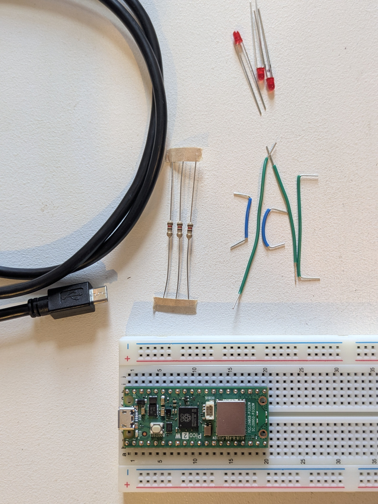
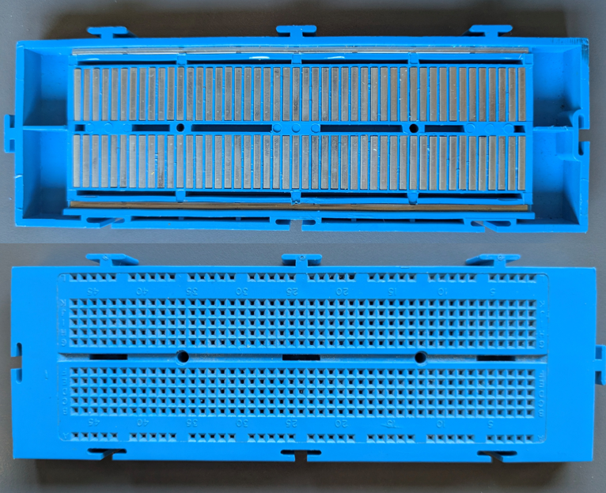
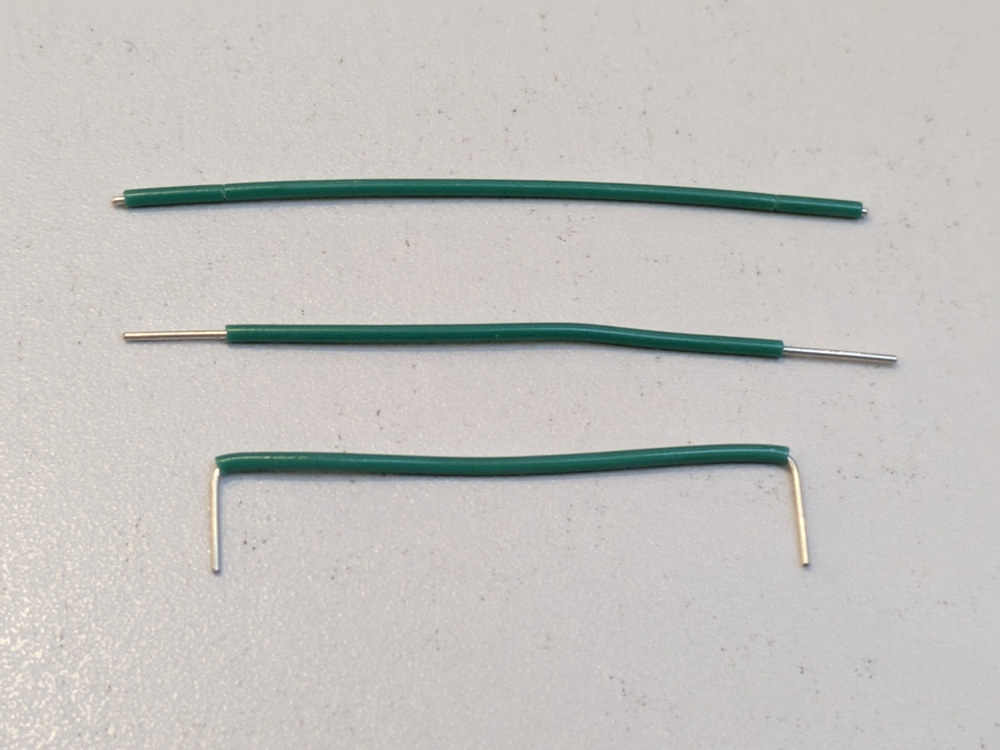
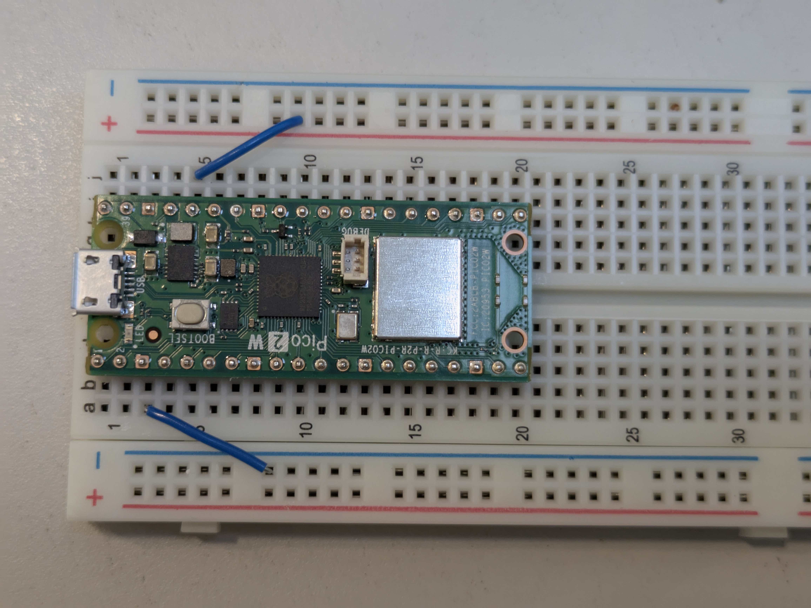
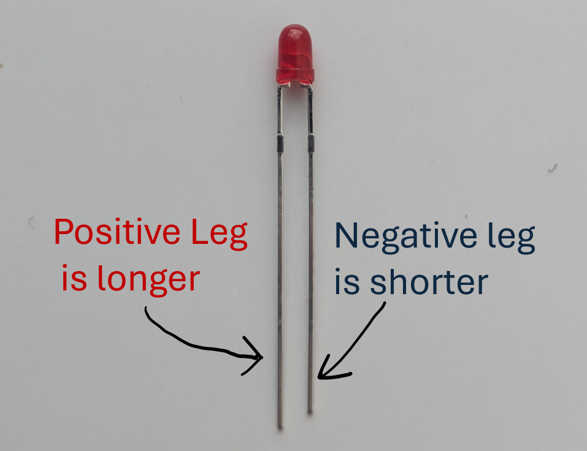
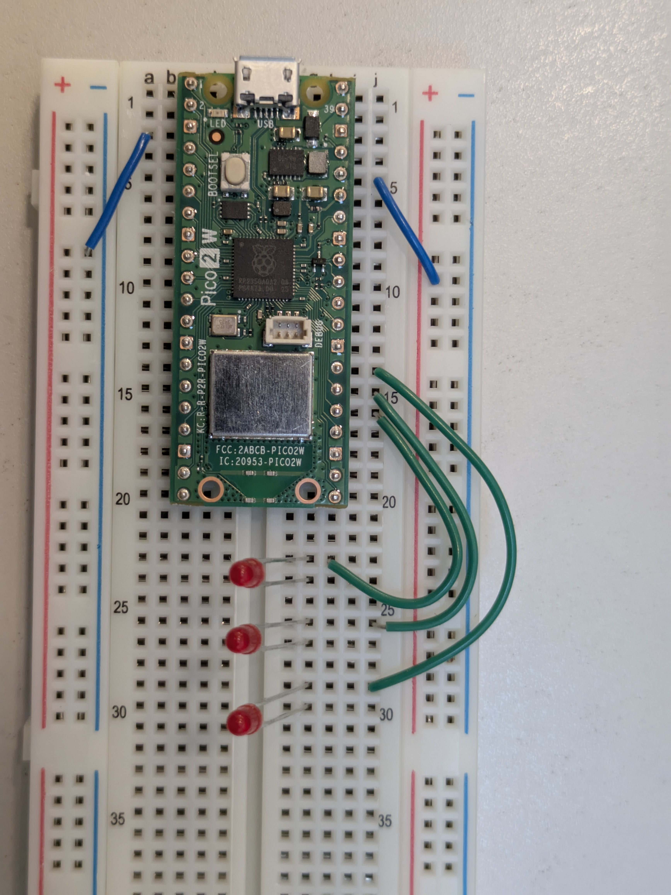
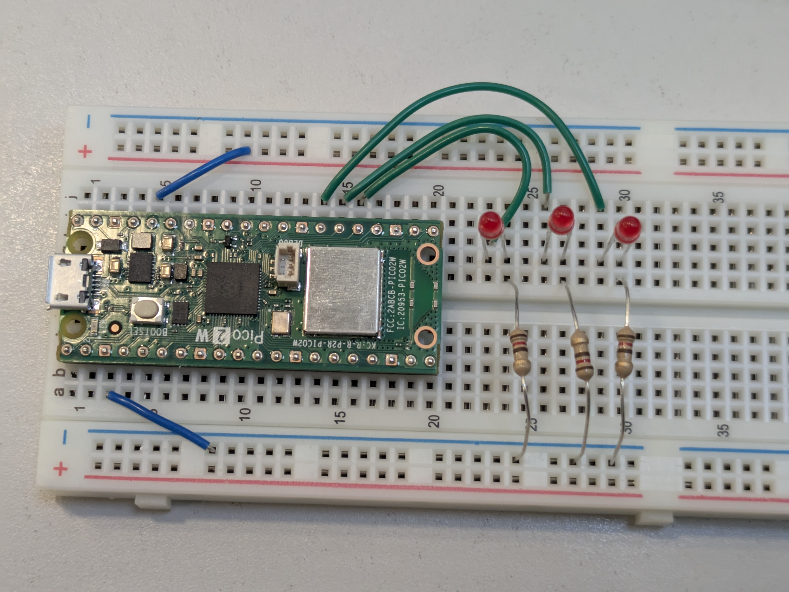

# 02 Flashing LEDs

We are going to be learning about how to use a breadboard, code and Pi Pico to control LEDs.

Here is the list of components you need:
 - Pi Pico 2 W 
 - Breadboard
 - Micro USB cable
 - x3 red LEDs
 - x3 120R resisters
 - x5 BreadBoard wires (you can always go back to get them when you know  what sizes you need)
 - Your own laptop or University laptop

 

## What is a Pi Pico?
It is a tiny computer or microccontroller that instead of running a operating system, runs a single program. It has pins along both sides to interact with hardware (e.g stuff on our breadboard).

Below is the pinout board diagram.


## What is a breadboard?

Breadboards let you prototype circuits. Components and wires plug into holes that are connected internally with metal strips.

In the picture below, I've taken apart a slightly different style of breadboard. You can see that anything plugged into the holes along the outer edges are electrically connected together with a metal strip, which usually carries ground or power. The holes in the middle are connected by short vertical metal strips, separated by a split along the center.


</details>

Looking at the breadboard, you should be able to identify which holes are connected and which aren't. **If you're unsure here, please don't hesitate to ask a supervisor.**

## Building on the breadboard

1. Make sure your Pi Pico is unplugged from your computer while building on  the breadboard.

2. Place the Pi Pico at the end of the breadboard. Line it up with the breadboards pin hole and carefully push down on all 4 corners of the Pi pico.

> [!NOTE]   
> You may find you need to pull of the  insulation at each end of the breadboard wires and bend the exposed ends 90 degrees.  
> 

3. The Pico provides power and ground to the bread board though special pins.  
Choose an appropriate length breadboard wire and connect the Pico's pins shown in the picture. The upper row is Power - 3.3V and the lower row is ground - 0V. 


> [!WARNING]  
> Make sure positive leg of the  LED, is the one connected to the pico's pins. Connecting it the wrong way will stop the LED from lighting (you can safely test this if you'd like).
> The long leg is referred to as the anode and the short leg is referred to as the cathode.
> 

> [!NOTE] Regarding Pins
> You'll hear us talking about "pins" quite often. These are the Pico's ways of connecting to circuits. The ground pin is (as one would expect) where you ground circuits, and the 3.3V pin is similarly intuitive. What is interesting are the GPIO pins.
> GPIO stands for General Purpose Input/Output. These are programmable pins that we can use to control electronic components.
> In this exercise, we'll use GP19, GP20, and GP21 to control our LEDs. These are the GPIO numbers not their physical locations (you can use the pinout diagram at the top of this page to map the physical locations of the pins to their respective numbers).

1. Next add the LEDs to the breadboard and connect the LED's positive legs to the correct  pins on the Pico, using breadboard wire.


1. The last step is to connect the other leg of the LED, to ground via 120R resistor. These resistors are important because they reduces the current flowing thought the LED, preventing it from burning out. 


## Creating and saving a program
1. Plug in the Pi Pico to the computer again. Press the red stop button near the top of the program to make it recognize the Pi Pico again.
1. To create a new python file. 
Go to the top "file"➡️"new".  
Then go "file"➡️"Save as..."➡️"This computer". Choose somewhere to save it with a name like "LedFlash.py". On university laptops save to your U drive.

## Controlling the LEDs

Each pin on the Pi Pico has a number. The following code tells the Pico that pins `19`, `20`, `21` are outputs and therefore can be used to control the LED as well as gives us a name we can reference in the code (`led1`, `led2` and `led3`).   
 Setting `.value(1)` means that pin is set to positive 3.3 volts, causing the connected LED to turn on.  

Type in the following code and click the green play button in the top left to run it:

```python
from machine import Pin

#define the LEDs pins
led1 = Pin(19, Pin.OUT)
led2 = Pin(20, Pin.OUT)
led3 = Pin(21, Pin.OUT)

#turn the LEDs on
led1.value(1)
led2.value(1)
led3.value(1)
```

**Before you move on**
It can be quite easy to copy and paste code and assume you understand everything now, before moving on, test your understanding with the following challenges.

*Challenge 1: Can you control the LEDs individually?*

Your code currently turns on all three LEDs. Can you modify the program so that only the middle LED lights up? Can you make the first and third LEDs light up while the middle one stays off?

*Challenge 2: Can you make an LED flash?*

Can you make an LED turn on for one second, then turn off for one second?

Can you repeat this forever using `while Ture:`?

> [!HINT]
> MicroPython executes instructions in order. If we want to introduce a delay, the code below will help:
```python 
from time import sleep

sleep(1) # Wait for one second
```

## Dimming the LEDs
We can write a program to smoothly dim the LEDs on and off.   
To give the illusion of dimming we can turn the LEDs on and off a very fast rate using pulse width modulation (PWM).  

In the new code `freq=5000` tell each pin to pulse on and off `5000` times a second, which is too fast for the human eyes to notice.  

By using `.duty_u16` we can change what percentage of the time the on part of the pulse lasts. `.duty_u16(0)` is off the entire pulse duration and `.duty_u16(65535)` means it stay on for the entire pulse duration (max brightness).   

Replace the old code with this then run it:


```python
from machine import Pin, PWM
from time import sleep_ms

#define the LEDs pins
led1 = Pin(19, Pin.OUT)
led2 = Pin(20, Pin.OUT)
led3 = Pin(21, Pin.OUT)

#Set up PWM on those pins
pwmled1 = PWM(led1, freq=5000)
pwmled2 = PWM(led2, freq=5000)
pwmled3 = PWM(led3, freq=5000)

#Loop forever
while True:
    #The duty is decremented in steps of 100

    # Gradually dimming LEDs
    for duty in range(65535, 0, -100):
        
        #Set the pulse duration for all LEDs
        pwmled1.duty_u16(duty)
        pwmled2.duty_u16(duty)
        pwmled3.duty_u16(duty)
        
        # Wait three millsecond
        sleep_ms(3)

    # Gradually brightening LEDs
    for duty in range(0, 65535, 100):
        
        #Set the pulse duration for all LEDs
        pwmled1.duty_u16(duty)
        pwmled2.duty_u16(duty)
        pwmled3.duty_u16(duty)
        
        # Wait three millsecond
        sleep_ms(3)
```

**Before you move on**
It can be quite easy to copy and paste code and assume you understand everything now, before moving on, test your understanding with the following challenges.

*Challenge 1: Experimenting with sleep lengths*

Try changing the value in `sleep_ms(3)`. What changes with the LEDs? Can you reason why this is the case?

*Challenge 2: Varying one LED*

Can you modify the code so that only one LED fades while the others stay on?