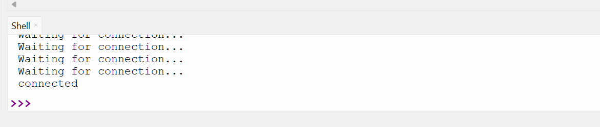
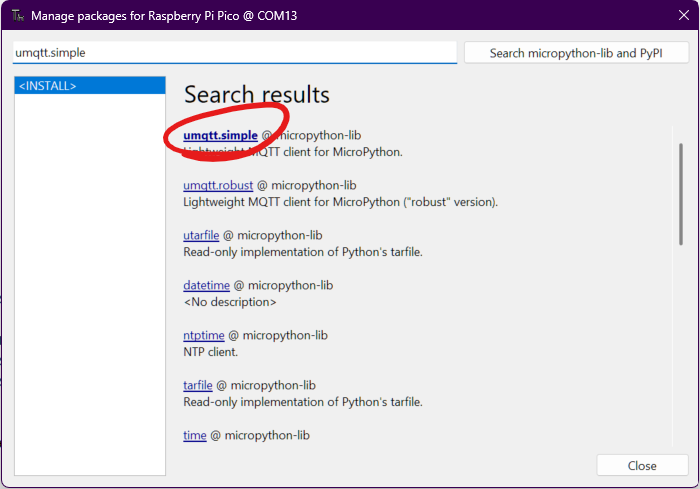
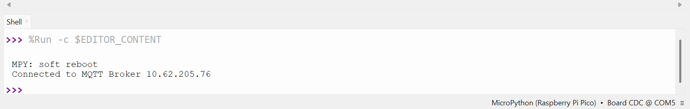

# 03 Connecting to MQTT Broker
In this exercise we will be learning how MQTT can be used used as a way for smart home devices to communicate with each other.

## Connecting the Pi Pico to Wi-Fi

1. Go to the top of Thonny and click "file"➡️"new". Then "file"➡️"Save as..."➡️"This computer". Call the  new file something like "MQTT.py" 

2. There are many wireless protocols smart homes can use. Today we are using Wi-FI

    The following code gives the Pi Pico the wifi credentials then connects it to the Wifi.
    
    **Copy and run this code.**

    ```python
    import network
    import time

    # Define Wi-Fi credentials
    SSID = 'NETGEAR05'
    PASSWORD = 'fuzzycurtain251'

    #Connect to WLAN as a client
    wlan = network.WLAN(network.STA_IF)
    wlan.active(True)
    wlan.connect(SSID, PASSWORD)

    #Loops until sucessfully connected
    while wlan.isconnected() == False:
        print('Waiting for connection...')
        time.sleep(1)
    print('connected')
    ```
    If it works successfully after waiting a few seconds you should see the following printed at the bottom of Thonny:
    

**Quick Experiment**

At the bottom of the code you've just copied, add the following line of code:

```python
print("My Pico's IP Address:", wlan.ifconfig()[0])
```

Assuming your code runs without error messages, you've successfully connected your Pico to Wi-Fi, but what does that actually mean?

You might notice that the IP address printed in Thonny is different to the one on display in the workshop.

So what's actually going on?

Essentially, you can think of Wi-Fi as invisible data cables, and your IP address as no different to a physical postal address. Your IP address identifies your device and where it is and the Wi-Fi lets you transmit messages to different IP addresses. The Wi-Fi actually connects you to something called a router (which is located at the IP address on the board), there are other devices connected via Wi-Fi. So now you can send messages to an address, and the router will receive the message via Wi-Fi, and forward it to the correct receiving device using Wi-Fi also.

If this is a convoluted mess of a conceptual model to wrap your head around, I understand. If you're confused, don't hesitate to discuss with a partner or one of the TinkerLab supervisors.

So if Wi-Fi is the medium through which we send our messages, what actually are the messages we're sending?

## What is MQTT and what is a broker?
MQTT is a lightweight protocol that smart home devices can use to communicate with each other.

Under MQTT, smart home devices send "messages" to a central "broker" - in this case, one called eclipse mosquito, running on a Orin Nivida Jetson (this is our router). Each message includes a "topic," such as `sensor/temperature/livingRoom`

The broker's job is to forward these messages to the appropriate MQTT devices. Devices "subscribe" to specific topics to receive messages. For example, an air conditioning unit might subscribe to `sensor/temperature/livingRoom` to get sent data from a temperature sensor in order to automatically adjust its cooling power based on the living room temperature.

## Connecting to the broker

2. By default the MQTT library is not installed. To install, at the  top of Thonny, click "Tools"➡️"Manage packages...". Then search `umqtt.simple` and click on the result highlighted in  the picture.

Click "Install" and when it is finished,  "Close".

2. We need to import a MQTT library. Add this to the top of the existing code
    ```python
    from umqtt.simple import MQTTClient
    ```
3. The following code tells the Pico where to find the MQTT broker on the local network.
Add the following to the bottom of the existing code. Make sure to change `UNIQUE NAME` to an actually unique name and replace `IP ADDRESS` with the one shown on the board.   

    **Add the following code to the bottom of you file, then run**
 

    ```python
    #MQTT setup
    server = "IP ADDRESS" #This is the IP address of the Mosquitto MQTT Broker
    serverPort = 1883 #This is the Mosquito MQTT Broker port
    clientId = "UNIQUE NAME" #Your Pi Pico needs to have a unique name

    client = MQTTClient(clientId, server, serverPort)

    #Connect to Mosquitto Broker
    client.connect()
    print('Connected to MQTT Broker ' + server)
    ```

   If it worked you will see a success message printed in the Thonny shell..

   

 | Code Section | What it means |
|--------------|---------------|
|`server = "IP ADDRESS"`|This is the network address of the computer running our MQTT broker|
|`serverPort = 1883`|The network port where the MQTT broker listens for connections|
|`clientId = "UNIQUE NAME"`|A unique identifier for this MQTT client, so the broke can tell clients apart|
|`client = MQTTClient(...)`|Creates an MQTT client object, containing the information needed to communicate with the broker|
|`client.connect()`|Actually connects our MQTT client to the broker|


This all might seem a little abstract at the minute, but in stage 04, you'll experiment with sending messages, which should help you get the hang of what's actually going on here.