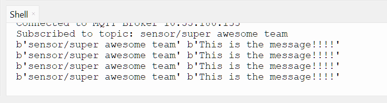

# 04 Sending Messages Between Devices. 
Now we know how to connect the pi pico's to the broker its time to send messages between devices.

**Make a pair with someone else that has a Pi Pico**. If you need help finding someone, ask a representative. One persons Pi Pico will be sending the messages and the other persons will be receiving the messages. 

## How does MQTT know where to send messages?
Imagine we've got three Picos connected to our broker.

One Pico is publishing a message containing the temperature of the room.

MQTT uses *topics* to organise these messages.

You can kind of think of topics as a message board. The publisher can send messages to the topic, subscribers can look at the topic and receive these messages as they are sent.

Both publishers and subscribers are MQTT clients. A single Pico can perform both roles.

So for example, consider Pico A publishing "22" to `sensor/temperature`. Pico B subscribes to `sensor/temperature` and Pico C subscribes to `sensor/humidity`. 

Pico B will receive the "22" message, but Pico C will not receive the message.

Keep in mind that Pico B will need to be told to check for messages that have been published to the topic.

## The sending Pi Pico

We need to tell one of the Pi Pico's to send its messages to a topic called `sensor/pairName`. You need to set the variable, `pairName` to a unique name, for your pair. 

Every 2 seconds `client.publish` is called to publish  the message to that topic.

**One of the members of the pair should add the following to bottom of there existing code in Thonny**. 

```python
#You need to give your pair a unique name
pairName = "UNIQUE PAIR NAME"

#The topic 
publishTopic = "sensor/"+pairName

#Loops forever
while True:
    #Publish  the message every 2 seconds
    client.publish(publishTopic, "This is the message!!!!")
    time.sleep(2)
```

**What's actually happening here?**
The pairName is used to create our topic, (e.g. `sensor/teamA`). The `publish()` function tells our MQTT client to send the message "This is the message!!!!" to the broker under thaat topic. Then any client subscribed to `sensor/teamA` can receive that message.

## The receiving Pi Pico

The other Pi Pico needs to subscribe to any messages sent to the topic `sensor/pairName`. `client.check_msg()` is continusly run and when a message is received, `messageRecieved` gets called.

**The other member of the pair should replace all of there code with  the following.** Make sure `clientId` is still changed to something unique, `IP ADDRESS` is the IP address shown on the board and `pairName` matches that of your pair.

```python
import network
import time
from umqtt.simple import MQTTClient


# Define Wi-Fi credentials
SSID = 'NETGEAR05'
PASSWORD = 'fuzzycurtain251'

#Connect to WLAN as a client
wlan = network.WLAN(network.STA_IF)
wlan.active(True)
wlan.connect(SSID, PASSWORD)

#Loops until sucessfully connected
while wlan.isconnected() == False:
    print('Waiting for connection...')
    time.sleep(1)
print('connected')


#Gets called when a message is received from  the other Pi Pico
def messageRecieved(topic, message):
    print(topic, message)
    

#MQTT setup
server = "IP ADDRESS" #This is the IP address of the Mosquitto MQTT Broker
serverPort = 1883 #This is the Mosquito MQTT Broker port
clientId = "UNIQUE NAME" #Your Pi Pico needs to have a unique name
    
client = MQTTClient(clientId, server, serverPort)
client.set_callback(messageRecieved) #Says what gets called when a messaged is received
client.connect()
print('Connected to MQTT Broker ' + server)


#Subscribing the Pico your pairs topic
pairName = "UNIQUE PAIR NAME"
subscribeTopic = "sensor/" + pairName
client.subscribe(subscribeTopic)
print('Subscribed to topic: ' + subscribeTopic)


#Checks for new messages forever
while True:
    client.check_msg()
```

**What's actually happening here?**
`client.subscribe(subscribeTopic)` tells the broker that our Pico is interested in messages sent to `subscribeTopic`, leading the broker to forward those messages to our Pico. Then `client.set_callback()` is a function that gets called when an event happens, here, we're telling the MQTT client which function to run when it receives a message. 

`client.check_msg()` checks whether a message has arrived. If one has, the MQTT library calls the function we registered ealier

Try run the new code on both the Pi Pico's. After waiting a few seconds the partner with the receiving Pi Pico should see the the messages being received in Thonny:  



**Experimentation to Reinforce Understanding**
Before moving on, to make sure you truly get what's going on, try the following:

*Challenge 1*
Your sending Pico currently publishes `"This is the message!!!!"`

1. Change the message to something else
2. Run the sender again
3. See what message the receiving Pico displays

*Challenge 2*
Your Picos are communicating successfully. Let's break that.

1. On the sending Pico, change your pairName to something different
2. Run the new code
3. See if the messages are still being received on the receiving Pico
4. Restore the original pair name and try again

Why did the messages stop appearing (Hint: look at how `publishTopic` and `subscribeTopic` are constructed)?

*Challenge 3*
Right now, your Pico sends the same message every 2 seconds.

Can you modify the sending code so that it sends

`Message 1`, `Message 2`, ...

The receiving Pico should display each message in order.

*Challenge 4*
When the receiving Pico gets a message, the MQTT library calls `messageReceived(topic, message)`. This is a "callback function". It allows our program to react when a message arrives, without knowing in advance when a message will be sent.

Can you modify `messageReceived()` so that it prints something like:

`"New message received: This is a message!!!!"`

Hint: MQTT messages arrive as bytes. Use message.decode() to turn them into a normal Python string.